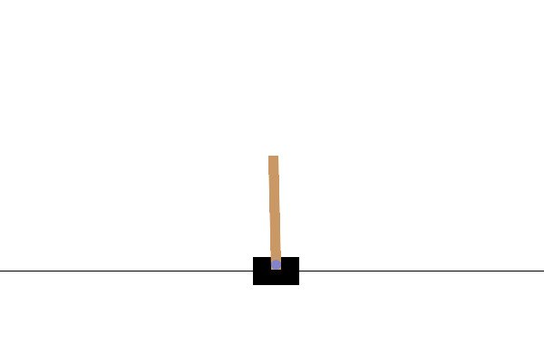
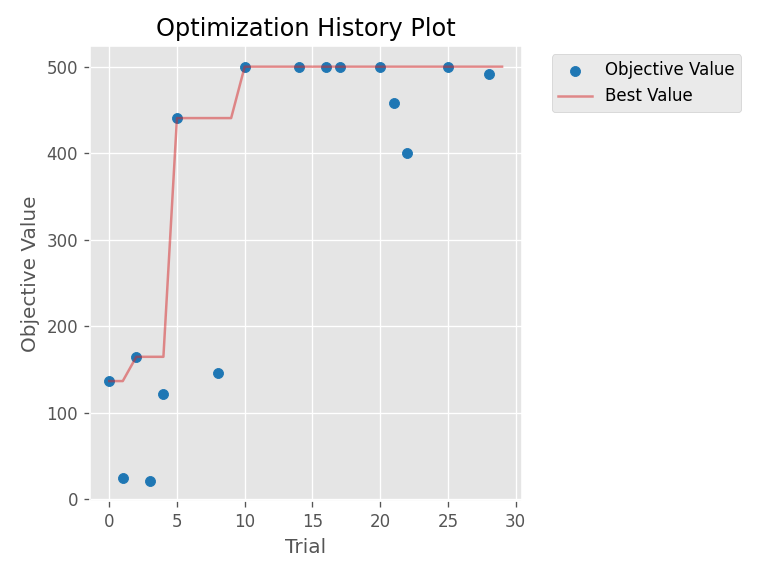
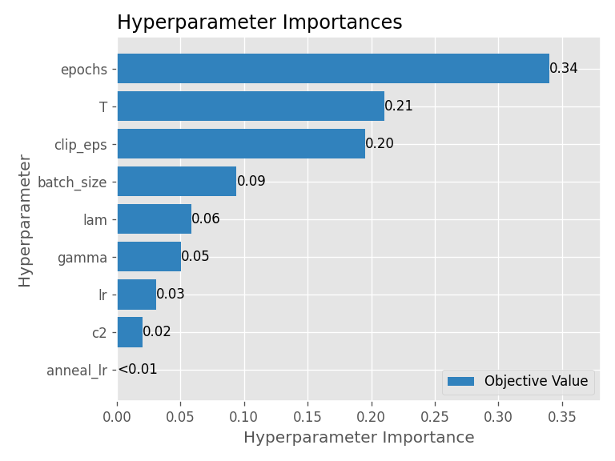

# PPO from Scratch (PyTorch)

實作一個簡單的 PPO 演算法 **Proximal Policy Optimization**，並在 Gymnasium `CartPole-v1` 上訓練。
程式碼註解附上每一步對應的公式，可以用於幫助學習。

<p align="center">
  
</p>

## 實作內容

- Actor-Critic 共用網路層（policy head + value head）
- **GAE (Generalized Advantage Estimation)**
- Clipped surrogate objective + value loss + entropy bonus
- Advantage 標準化、梯度裁剪、學習率線性衰減
- 固定 seed，結果可重現
- 使用 **Optuna** 自動搜尋超參數（TPE + Pruning）

## 專案結構

```
ppo/
  model.py      # ActorCritic 網路
  buffer.py     # 收集軌跡 collect() + compute_gae()
  update.py     # ppo_update()：PPO 的 loss 與參數更新
train.py        # 訓練程式碼，argparse 設定超參數，存 checkpoint 與訓練紀錄
tune.py         # 用 Optuna 自動搜尋超參數
evaluate.py     # 載入模型評估、錄製 GIF、隨機策略對照
results/
  *.csv         # 每局分數紀錄
  optuna/       # 超參數搜尋結果（trials.csv、最佳參數、圖表）
```

## 安裝

```bash
pip install -r requirements.txt
```

## 使用方式

```bash
# 訓練（預設 150 輪 × 512 步，CPU 約 1~2 分鐘）
python train.py

# 手動調整超參數
python train.py --iterations 300 --clip-eps 0.1 --lam 0.9 --anneal-lr --seed 2

# 評估，看 agent 玩
python evaluate.py --checkpoint checkpoints/ppo_CartPole-v1_seed1.pt --render

# 錄成 GIF
python evaluate.py --checkpoint checkpoints/ppo_CartPole-v1_seed1.pt --gif assets/cartpole.gif

# 隨機策略當作對照組
python evaluate.py --checkpoint checkpoints/ppo_CartPole-v1_seed1.pt --random
```

所有參數可以用 `python train.py --help` 查看。

```bash
# 自動搜尋超參數（30 組）
python tune.py --n-trials 30

# 每組參數跑 3 個 seed 取平均
python tune.py --n-trials 20 --n-seeds 3
```

所有參數可以用 `python tune.py --help` 查看。

## 結果

預設超參數、seed = 1，訓練約 77k 步，評估 5 局（選機率最高的動作）：

| Policy | 平均分數 | 最高 | 最低 |
|---|---|---|---|
| Random | 26.6 | 47 | 18 |
| PPO | 293.4 | 500 | 192 |


## 超參數搜尋 (Optuna)

### 設定

| 項目 | 設定 |
|---|---|
| 搜尋演算法 | TPE（根據過去結果挑選較有希望的參數） |
| 提早淘汰 | MedianPruner：訓練超過 1/4 後，若分數低於先前 trial 的中位數就停止 |
| 評分標準 | 訓練最後 20 局的平均分數 |
| 訓練預算 | 每個 trial 固定 76,800 步（T 不同時，輪數會跟著調整，比較才公平） |
| 試驗次數 | 30 個 trial，每個 trial 1 個 seed |

搜尋範圍：

| 參數 | 範圍 | 參數 | 範圍 |
|---|---|---|---|
| `lr` | 1e-4 ~ 3e-3（以 log 調整） | `epochs` | 1 ~ 10 |
| `clip_eps` | 0.1 ~ 0.3 | `batch_size` | 32, 64, 128, 256 |
| `gamma` | 0.95, 0.98, 0.99, 0.995 | `T` | 128, 256, 512, 1024 |
| `lam` | 0.8 ~ 1.0 | `c2` | 0 ~ 0.05 |
| `anneal_lr` | 開 / 關 | | |

### 結果

30 個 trial 中，16 個完整跑完、14 個被提早淘汰，其中 **6 個達到滿分 500**。

<p align="center">
  
  
</p>

- **左圖**：每個點是一個 trial 的分數，紅線是目前最高分。第 10 個 trial 就達到 500 分，之後 TPE 挑出的參數大多落在 400 分以上。
- **右圖**：參數重要性。**epochs、T、clip_eps** 影響最大；lr、c2、anneal_lr 在這個範圍內影響很小。

### 說明：訓練量影響很大

比較分數 ≥ 400 和分數 < 200 的 trial：

| | 分數 ≥ 400（10 個） | 分數 < 200（6 個） |
|---|---|---|
| epochs | 全部 7 ~ 10 | 多數 1 ~ 5 |
| batch_size | 全部 32 或 64 | 多數 256 |
| gamma | 全部 0.99 或 0.995 | 多數 0.95 或 0.98 |

epochs 大、batch 小，代表同一批資料做了更多次梯度更新。整個訓練的總更新次數為：


| | 總更新次數 | 分數 |
|---|---|---|
| 預設參數（epochs=4, batch=64） | 4,800 | — |
| 分數 ≥ 400 的 trial | **8,400 ~ 21,600** | 400 ~ 500 |
| 分數 < 200 的 trial | 300 ~ 2,700（只有 1 個例外） | 21 ~ 165 |


最佳參數之一（trial 17）：

```bash
python train.py --lr 0.000544 --clip-eps 0.227 --gamma 0.995 --lam 0.872 --epochs 10 --batch-size 64 --T 512 --c2 0.0063
```

完整紀錄：[`results/optuna/ppo_cartpole/trials.csv`](results/optuna/ppo_cartpole/trials.csv)

## 重點公式

**GAE**

$$\delta_t = r_t + \gamma V(s_{t+1})(1 - \text{terminated}_t) - V(s_t)$$

$$A_t = \delta_t + \gamma \lambda A_{t+1} (1 - \text{done}_t)$$

**PPO Clipped Objective**

$$r_t(\theta) = \frac{\pi_\theta(a_t|s_t)}{\pi_{\theta_\text{old}}(a_t|s_t)}$$

$$L^{CLIP} = \mathbb{E}\left[\min\left(r_t A_t,\ \text{clip}(r_t, 1-\epsilon, 1+\epsilon) A_t\right)\right]$$

**總 Loss**

$$L = -L^{CLIP} + c_1 \cdot \tfrac{1}{2}(R_t - V(s_t))^2 - c_2 \cdot H[\pi_\theta]$$

## 參考資料

- Schulman et al., [Proximal Policy Optimization Algorithms](https://arxiv.org/abs/1707.06347), 2017
- Schulman et al., [High-Dimensional Continuous Control Using Generalized Advantage Estimation](https://arxiv.org/abs/1506.02438), 2015
- Akiba et al., [Optuna: A Next-generation Hyperparameter Optimization Framework](https://arxiv.org/abs/1907.10902), KDD 2019
- Huang et al., [The 37 Implementation Details of PPO](https://iclr-blog-track.github.io/2022/03/25/ppo-implementation-details/), ICLR Blog Track 2022
